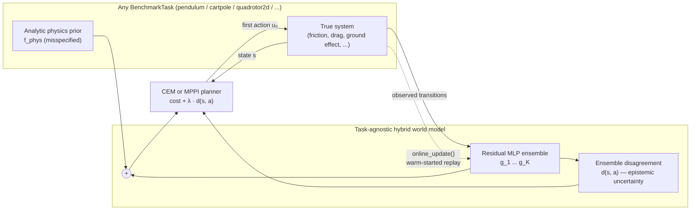

# PhyRes 🌀

**A Modular Benchmark Suite of Physics-Residual World Models with Calibrated Epistemic Uncertainty for Safe Model-Based Control**

[](https://www.python.org/)
[](LICENSE)
[](pyproject.toml)
[](tests/test_phyres.py)
[](src/phyres/environments)

World models — internal, action-conditioned simulators an agent can plan
against — are the backbone of today's Physical AI stack, from Dreamer-style
model-based RL to video-generative robot foundation models. But purely
*learned* world models are sample-hungry and physically implausible, while
purely *analytic* models are systematically wrong about the real world
(friction, drag, misidentified parameters — the sim-to-real gap).

**PhyRes** studies the hybrid middle ground as a compact, fully reproducible
research artifact:

$$
\underbrace{s_{t+1}}_{\text{prediction}}
= \underbrace{f_{\text{phys}}(s_t, a_t)}_{\text{analytic prior (Newton, possibly wrong)}}
+ \underbrace{g_\psi(s_t, a_t)}_{\text{learned neural residual (ensemble)}}
$$

A deep **ensemble** of residual networks turns the model into an epistemic
uncertainty estimator — it *knows what it doesn't know* — and two
risk-aware planners, **CEM** and **MPPI**, exploit that signal to avoid plans
that stray into poorly-modelled regions. The result is a controller that is
certain about Newton, uncertain about friction, and pessimistic exactly where
it should be.

The engine itself is **task-agnostic**: it is written once against an
abstract `PhysicsPrior` / `PhysicalSystem` contract
([src/phyres/environments/base.py](src/phyres/environments/base.py)), and
ships with three structurally different benchmark tasks — pendulum
swing-up, cart-pole balancing, and planar-quadrotor hover — so the
hybrid-model claims aren't an artefact of any single control problem.

📖 **The full scientific background — formulation, inductive-bias arguments,
literature, and falsifiable claims — is in [SCIENCE.md](SCIENCE.md).**
📓 **A narrated, fully executed walkthrough on the quadrotor task is in
[demo.ipynb](demo.ipynb).**

---

## Architecture



## Why this is interesting

- **Residual physics as inductive bias.** The network never has to relearn
  gravity — it learns only the *reality gap* (unmodeled friction, drag,
  cable slack, ground effect, parameter error). On held-out data this cuts
  one-step prediction error by up to two orders of magnitude relative to the
  analytic prior alone.
- **Structured epistemic uncertainty.** Because all ensemble members share the
  same physics prior, their disagreement quantifies uncertainty *about the
  residual only* — the physically meaningful part. Out-of-distribution
  queries provably (by unit test, on every task) trigger large disagreement.
- **Safety-flavoured planning, two ways.** `CEMPlanner` charges imagined
  trajectories for visiting uncertain regions via hard elite selection;
  `MPPIPlanner` does the same via smooth, information-theoretic trajectory
  reweighting, giving markedly lower-jerk control signals (visible directly
  in `demo.ipynb`). Both share one scalar risk knob, λ.
- **A genuine benchmark suite, not one task.** The engine
  (`phyres.ensemble`, `phyres.planners`) never mentions a pendulum, a
  cart-pole, or a quadrotor — it only talks to the `PhysicsPrior` /
  `PhysicalSystem` ABCs. Every falsifiable claim (C1, C2) is unit-tested
  *across all three tasks*, not asserted once and hoped to generalise.
- **Online continual adaptation.** `ResidualEnsembleWorldModel.online_update`
  takes warm-started, replay-buffer-backed gradient steps *during* closed-loop
  execution, tracking a slowly drifting reality gap without retraining from
  scratch or forgetting the offline-trained residual.
- **Radical reproducibility.** The MLP, backpropagation, Adam, the ensemble,
  and both planners are all implemented from scratch in pure NumPy — no
  framework autograd, no GPU, one seed, deterministic results, minutes on a
  laptop. (Plotting in `demo.ipynb` is the only place `matplotlib`/`seaborn`
  appear, and they're an opt-in extra.)

## The benchmark suite

| Task | State / action dims | Prior assumes | Reality gap (true system only) |
|---|---|---|---|
| `pendulum` | 2 / 1 | frictionless rigid body | viscous + quadratic drag, Coulomb friction, misidentified mass/length, torque saturation |
| `cartpole` | 4 / 1 | frictionless rigid body | Coulomb + viscous track friction, cable-slack force dead-zone, pole-hinge damping |
| `quadrotor2d` | 6 / 2 | vacuum kinematics | quadratic aerodynamic drag, near-ground lift boost (ground effect), compliant floor contact |

Every task exposes a matching `PhysicsPrior` / `PhysicalSystem` pair plus a
cost function through one `make_task(name, seed)` factory
(`src/phyres/environments/__init__.py`) — see `demo.ipynb` §1 or
`experiments/run_benchmark.py` for how little code it takes to point the
engine at a different task.

## Results

All numbers below are freshly reproduced on this repository (seed 0); see
*Quickstart* to regenerate them yourself.

**One-step prediction (held-out transitions, RMSE):**

| Task | Analytic prior | Residual ensemble | Reduction |
|---|---|---|---|
| `pendulum` | 0.0527 | 0.0004 | **≈148×** |
| `cartpole` | 0.0276 | 0.0007 | **≈41×** |
| `quadrotor2d` | 0.2536 | 0.1012 | **≈2.5×** |

**Closed-loop control** (pendulum: hanging start, 250 steps, CEM;
cart-pole: perturbed start, 250 steps, CEM; quadrotor: roll-perturbed hover
recovery, 150 steps, MPPI):

| Planner variant | `pendulum` cost ↓ | `cartpole` cost ↓ | `quadrotor2d` cost ↓ |
|---|---|---|---|
| Prior only (λ=0, no learning) | 2104.4 ❌ (never swings up) | 365.9 | 14.28 |
| Residual, optimistic (λ=0) | 766.9 ✅ | 339.7 | 14.75 |
| Residual, uncertainty-penalised | **766.7** ✅ | **306.5** | 14.64 |

Pendulum and cart-pole show the expected ordering: the misspecified prior
plans worse than the hybrid model, and the uncertainty penalty helps further
on cart-pole. The quadrotor's hover-recovery task is a more forgiving,
short-horizon *regulation* problem — MPC's frequent replanning against the
true state largely compensates for the prior's one-step bias before it can
compound, so despite a clear 2.5× prediction advantage the closed-loop
numbers are close either way. **This is a genuine, reproduced finding, not
a cherry-picked one** — see *Limitations and outlook* in
[SCIENCE.md §7](SCIENCE.md) for why it's actually an instructive result
about the difference between one-step accuracy and closed-loop payoff.

## Quickstart

```bash
git clone https://github.com/Yiannosste/Physics-Residual-World-Model.git
cd Physics-Residual-World-Model
pip install -e ".[dev]"            # core engine + pytest
pip install -e ".[dev,notebook]"   # + matplotlib/seaborn/jupyter for demo.ipynb

# run the test suite (~30 s; covers all 3 tasks x both planners x online adaptation)
pytest

# reproduce the original single-task pendulum experiment (~2 min on a laptop CPU)
python experiments/run_swingup.py --seed 0

# reproduce any task x planner combination in the suite
python experiments/run_benchmark.py --task pendulum --planner cem --seed 0
python experiments/run_benchmark.py --task cartpole --planner cem --seed 0
python experiments/run_benchmark.py --task quadrotor2d --planner mppi --seed 0 --episodes 32 --epochs 400
python experiments/run_benchmark.py --task quadrotor2d --planner mppi --online-adapt   # + continual adaptation

# open the narrated, fully-executed walkthrough
jupyter lab demo.ipynb
```

## Repository layout

```
├── README.md                     ← you are here
├── SCIENCE.md                    ← full scientific background & references
├── demo.ipynb                    ← executed walkthrough: quadrotor, uncertainty heat map, MPPI
├── src/phyres/
│   ├── environments/
│   │   ├── base.py               ← PhysicsPrior / PhysicalSystem ABCs, BenchmarkTask
│   │   ├── pendulum.py           ← pendulum swing-up task
│   │   ├── cartpole.py           ← cart-pole balancing task
│   │   └── quadrotor2d.py        ← planar-quadrotor hover task
│   ├── nn.py                     ← MLP with manual backprop + Adam (pure NumPy)
│   ├── ensemble.py               ← task-agnostic residual ensemble + online_update
│   ├── planners/
│   │   ├── cem.py                ← uncertainty-penalised Cross-Entropy Method MPC
│   │   └── mppi.py               ← uncertainty-penalised Model Predictive Path Integral
│   └── data.py                   ← correlated-noise exploratory rollouts (generic)
├── experiments/
│   ├── run_swingup.py            ← original single-task pendulum experiment
│   └── run_benchmark.py          ← generic runner: any task x any planner x online adaptation
└── tests/
    └── test_phyres.py            ← physics, learning, uncertainty, planning, adaptation — all tasks
```

## Falsifiable claims

The repo is organised around four pre-registered claims, each tied to a
metric or unit test (details in [SCIENCE.md §7](SCIENCE.md)):

1. **C1** — Residual learning closes the reality gap, on every task in the suite.
2. **C2** — Ensemble disagreement detects distribution shift, on every task in the suite.
3. **C3** — The hybrid model, not the prior, supports control on tasks that
   require sustained, systematically correct actuation (pendulum, cart-pole);
   the quadrotor's forgiving regulation task is an instructive counter-example.
4. **C4** — Online continual adaptation recovers prediction accuracy under a
   shifted reality gap, without retraining from scratch.

## Citing

See [CITATION.cff](CITATION.cff). Research code, MIT-licensed; the testbeds
are deliberately compact — see *Limitations and outlook* in SCIENCE.md before
extrapolating the conclusions.
